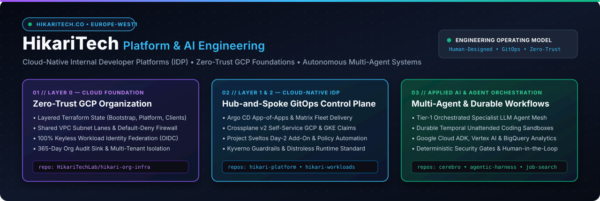

<div align="center">
  
</div>

<br />

<div align="center">

[](https://github.com/HikariTechLab/.github/actions/workflows/validate-profile.yml)
[](https://github.com/HikariTechLab)
[](https://github.com/HikariTechLab/hikari-org-infra)
[](./SECURITY.md)

</div>

# HikariTechLab — Organization `.github` Repository

This repository is the central **organization landing page**, **engineering governance**, and **community health** source of truth for **[HikariTech (`hikaritech.co`)](https://github.com/HikariTechLab)**.

Templates and policies defined here (`SECURITY.md`, `CONTRIBUTING.md`, `CODE_OF_CONDUCT.md`, `SUPPORT.md`, and `.github/` issue/PR templates) are automatically inherited across all `HikariTechLab` repositories unless overridden locally.

---

## Repository Structure

```text
.github/
├── profile/
│   ├── README.md                           # Organization landing page rendered at github.com/HikariTechLab
│   └── assets/
│       ├── hikari-banner.svg               # Executive hero banner for the organization profile
│       └── idp-ecosystem.svg               # 3-Layer Cloud-Native IDP (L0/L1/L2) & AI Ecosystem diagram
├── .github/
│   ├── workflows/
│   │   └── validate-profile.yml            # Hardened CI check (SHA-pinned, ubuntu-24.04) for SVGs & templates
│   ├── PULL_REQUEST_TEMPLATE.md            # Default organization Pull Request template
│   └── ISSUE_TEMPLATE/
│       ├── config.yml                      # Issue chooser configuration & security advisory routing
│       ├── infra_change.yml                # Cloud Foundation (L0), IDP Control Plane (L1) & Claim (L2) requests
│       ├── feature_spec.yml                # Feature & Agentic capability specification template
│       └── bug_report.yml                  # Deterministic bug & regression report template
├── CONTRIBUTING.md                         # Engineering workflow, CI/CD supply-chain rules & stack standards
├── SECURITY.md                             # Vulnerability disclosure & Zero-Trust GCP/Kubernetes guardrails
├── CODE_OF_CONDUCT.md                      # Organization Code of Conduct
├── SUPPORT.md                              # Support channels & repository routing matrix
└── README.md                               # This document
```

---

## Organization Engineering Invariants

1. **PR-Only Infrastructure & GitOps Reconciliation**:
   - Every change to our Google Cloud organization ([`hikari-org-infra`](https://github.com/HikariTechLab/hikari-org-infra)), Kubernetes IDP control plane ([`hikari-platform`](https://github.com/HikariTechLab/hikari-platform)), and tenant workloads ([`hikari-workloads`](https://github.com/HikariTechLab/hikari-workloads)) lands via Pull Request.
2. **Hardened CI/CD Supply Chain**:
   - Never use `ubuntu-latest` or `:latest` container tags in CI or Kubernetes manifests; always pin runner OS versions (e.g., `ubuntu-24.04`) and container image digests/versions.
   - Always pin GitHub Actions to full **40-character commit SHAs** (`uses: owner/action@<sha> # vX.Y.Z`) with `persist-credentials: false`.
3. **Zero Static Credentials**:
   - Authenticate to Google Cloud exclusively via **Workload Identity Federation (OIDC)** in CI/CD and GKE Workload Identity in-cluster.
