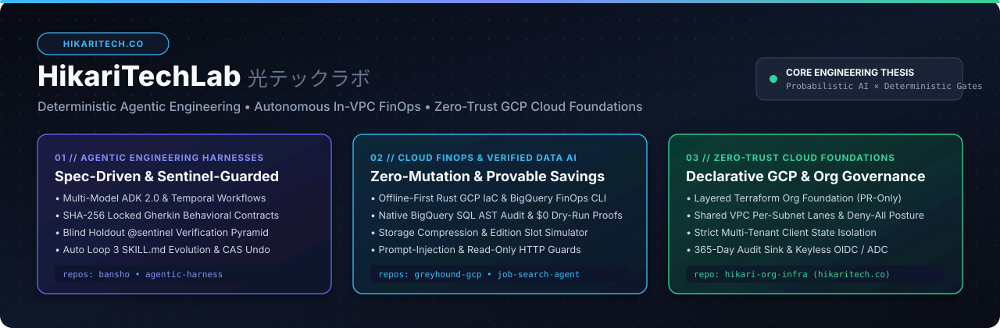
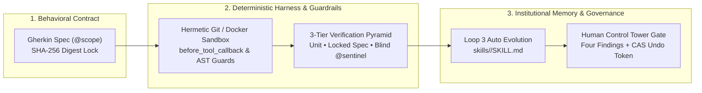

  

 

---

## Who We Are

**HikariTechLab (光テックラボ)** is an AI systems and cloud platform engineering organization focused on **Deterministic Agentic Engineering**, **Autonomous In-VPC FinOps**, and **Zero-Trust Google Cloud Foundations**.

We build systems around a single architectural conviction:

> **Probabilistic models belong inside deterministic engineering harnesses.**
>
> Giving an unconstrained LLM write access to a codebase or cloud environment invites four systemic failure modes: *ambiguous specifications*, *reward hacking (Goodhart's Law)*, *unbounded blast radius*, and *irreversible side effects*. At **HikariTechLab**, deterministic code—not an LLM—owns the state machine, locks behavioral contracts with SHA-256 digests, enforces AST and path-level guardrails, verifies candidates against blind holdout sentinels, and mints atomic rollback tokens before a human ever promotes a change.

---

## Flagship Systems & Repositories

| Repository | Domain | Architecture & Key Guarantees | Stack |
| :--- | :--- | :--- | :--- |
| **[`bansho`](https://github.com/HikariTechLab/bansho)** *(番所 — The Watchtower)* | **Spec-Driven Agentic Coding Engine** | 3-Loop Self-Improving Flywheel (`bansho-spec` → `bansho-worker` → `bansho-evolve` / AEOS 3), 3-Tier Verification Pyramid (Unit + SHA-256 Locked Gherkin + Blind `@sentinel` suite), Multi-Model FinOps Router, and stateless Compare-and-Swap (CAS) Undo tokens. | Python, Google ADK 2.0, FastAPI, TypeScript CLI, React 19, OpenTelemetry |
| **[`greyhound-gcp`](https://github.com/HikariTechLab/greyhound-gcp)** | **Autonomous In-VPC BigQuery FinOps Agent** | Customer-hosted SQL optimization & FinOps arbitrage agent. Proves exact `$0` `--dry_run` byte savings and mathematical data equivalence (`EXCEPT DISTINCT` + `FARM_FINGERPRINT` XOR checksums) under a strict Zero-Mutation `sqlglot` AST whitelist. | Python, Google ADK, Vertex AI, BigQuery, `sqlglot` |
| **[`hikari-org-infra`](https://github.com/HikariTechLab/hikari-org-infra)** | **Zero-Trust GCP Organization Foundation** | Declarative Terraform source of truth for `hikaritech.co`. Layered GCS state (`bootstrap/`, `apps/`, `clients/`), Shared VPC per-subnet isolation (`europe-west1`), default-deny firewall posture, 365-day org audit sink, and strict multi-tenant client isolation. | Terraform, Google Cloud Platform, Cloud Identity, BigQuery Billing |
| **[`agentic-harness`](https://github.com/HikariTechLab/agentic-harness)** | **Durable Unattended Coding Control Plane** | Orchestrates unattended issue-to-PR coding runs inside ephemeral Docker sandboxes using Temporal workflows, calibrated decision-model diff gating (`fast_track` vs `senior_review`), and durable human-in-the-loop merge gates. | Python 3.13, Temporal, Docker, OpenRouter / Jev, Aider |
| **[`job-search-agent`](https://github.com/HikariTechLab/job-search-agent)** | **Autonomous Opportunity Intelligence Agent** | Discovers, deduplicates, sanitizes (`<untrusted_job_description>`), and scores worldwide remote Cloud/SRE/Platform/AI Infrastructure roles on a `0–100` rubric into BigQuery & Looker Studio with hard API quota guardrails. | Python, Google ADK, Vertex AI (`gemini-3.8-flash`), BigQuery |
| **[`bansho-demo-api`](https://github.com/HikariTechLab/bansho-demo-api)** | **Reference 20% Business Cartridge** | Target microservice demonstrating Bansho's repository guardrail contract: `skill.yaml` manifest, evolvable `skills/<domain>/SKILL.md` domain memory, visible Gherkin specs (`tests/specs/`), and hidden holdout invariants (`sentinels/`). | Python, FastAPI, Pytest, Gherkin |
| **[`aftermark`](https://github.com/HikariTechLab/aftermark)** | **Setup-First Trading Journal** | Rule-and-setup-first trading journal for Hyperliquid. Links live fills from the public Hyperliquid Info API to explicit setup rules, invalidation criteria, and post-trade notes. | Bun, Next.js, TypeScript, Tailwind CSS, Drizzle, Postgres |

---

## Our Engineering Architecture & Invariants

### 1. The 3-Tier Verification Pyramid & Sentinel Blindness
We never trust an agent to grade its own homework. Repositories managed by our harnesses separate verification into three distinct tiers:
- **Tier 1 — Component & Unit (`test_scope`)**: Fast deterministic unit tests, static typing, and syntax validation (`pytest`, `vitest`, `bun test`, `terraform validate`).
- **Tier 2 — Locked Behavioral Spec (`tests/specs/**`)**: Formal `Given / When / Then` Gherkin specifications compiled and locked with a **SHA-256 digest** before the worker agent runs.
- **Tier 3 — Blind Holdout Sentinels (`sentinels/**`)**: Out-of-sample security, billing, SLA, and architectural invariants. Our tool guardrails (`before_tool_callback`) physically block agents from reading `sentinels/**` and redact stack traces on failure—defeating Goodhart's Law by construction.

### 2. Zero-Mutation & Anti-Prompt-Injection Defense
Every agent handling external telemetry or database queries runs behind deterministic security plugins:
- **AST-Level Read-Only Whitelisting**: In [`greyhound-gcp`](https://github.com/HikariTechLab/greyhound-gcp), every SQL statement is parsed via `sqlglot` (`dialect="bigquery"`) to strip 100% of SQL comments, reject any non-`SELECT` or mutating subtree, and lock `QueryJobConfig` with a 1 GiB circuit breaker (`maximum_bytes_billed`).
- **Untrusted Input Delimiting & Session-Poisoning Handshakes**: External inputs (job descriptions, query logs, test outputs) are sanitized, wrapped in explicit XML boundary tags, and checked by `on_user_message_callback` → `before_run_callback` guards before entering model context.

### 3. Self-Improving Domain Memory (AEOS 3) & Stateless Rollback
- **Evolvable `SKILL.md` Cartridges**: When a candidate passes verification, Loop 3 (`bansho-evolve`) updates *only* `skills/<domain>/SKILL.md` on a dedicated `skill/<ticket_id>` branch—encoding repository-specific lessons so future tasks succeed on the first attempt.
- **Compare-and-Swap (CAS) Undo**: Every agentic execution mints a stateless `CASUndoToken` (`before_version` → `after_version`) alongside **The Four Findings** (`Changed`, `Improved`, `Degraded`, `Recommended Action`), enabling 1-click atomic rollback if `HEAD == after_version`.

### 4. Declarative, PR-Only Cloud Infrastructure
In [`hikari-org-infra`](https://github.com/HikariTechLab/hikari-org-infra), the repository is the sole source of truth for the `hikaritech.co` GCP organization:
- **Never fix the org in the console**: Drift dies in Git or lives forever. Rollback is `git revert` + `make plan` + `make apply`.
- **Layered Blast-Radius Isolation**: Layer 0 (`bootstrap/`) governs org folders, Shared VPCs, and centralized 365-day audit logging; Layer 1 (`apps/<app>/<env>` and `clients/<client>/<env>`) isolates every application and client tenant into its own remote state prefix, dedicated service accounts, budgets, and mandatory cost-attribution labels.

---

## Technology Stack

| Layer | Technologies & Standards |
| :--- | :--- |
| **Agentic & AI Frameworks** | Google Agent Development Kit (**ADK 2.0**), Vertex AI (`gemini-3.8-flash`, `gemini-2.5-pro`), LiteLLM (Claude Sonnet 4, GPT-4.1, OpenRouter), Temporal Workflows |
| **Cloud & Infrastructure** | Google Cloud Platform (`europe-west1`), Terraform (Layered GCS State), Shared VPC, Cloud Run, Vertex AI Agent Engine, Secret Manager, Cloud Identity |
| **Data, FinOps & Observability** | BigQuery (`INFORMATION_SCHEMA`, Dry-Run & Equivalence Proofs), `sqlglot`, Looker Studio, OpenTelemetry, JSONL FinOps Ledgers |
| **Languages & Tooling** | Python 3.12 / 3.13 (`uv`, `ruff`, `pyright`, `pytest`, `pydantic`), TypeScript (`bun`, Node.js, `@clack/prompts`, `biome`, `vitest`), React 19, Next.js, Tailwind CSS |

---

  Built with discipline by <strong>HikariTechLab (hikaritech.co)</strong> • <a href="https://github.com/HikariTechLab/.github/blob/main/CONTRIBUTING.md">Contributing</a> • <a href="https://github.com/HikariTechLab/.github/blob/main/SECURITY.md">Security Policy</a>

