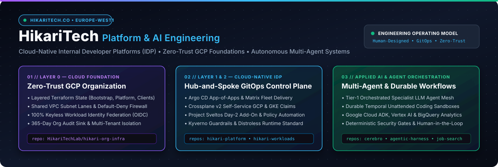
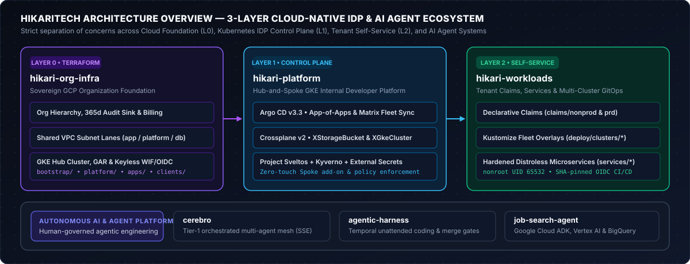

  

 

---

## About HikariTech

**HikariTech (`hikaritech.co`)** is a Cloud-Native Platform Engineering and AI Systems organization specializing in **Sovereign Google Cloud Foundations**, **Kubernetes Internal Developer Platforms (IDP)**, and **Human-Governed Multi-Agent Engineering**.

Our engineering philosophy combines two disciplines:
1. **Zero-Ticket Cloud-Native Platforms**: Infrastructure is a product, not a ticket queue. By separating our Google Cloud organization into three declarative GitOps layers (**L0 Cloud Foundation**, **L1 IDP Control Plane**, and **L2 Tenant Self-Service**), developers provision production-hardened cloud resources and Kubernetes workloads through a single Pull Request—with zero static credentials and automated Day-2 security guardrails.
2. **Human-Designed Software, Agent-Accelerated Delivery**: Autonomous coding and data agents operate inside deterministic sandboxes, strict supply-chain controls, and human-in-the-loop merge gates.

---

## Architecture Overview

  

---

## Platform & Repository Portfolio

### 1. Cloud-Native Internal Developer Platform (3-Layer Hub-and-Spoke on GCP)

| Layer | Repository | Role & Architectural Guarantees | Core Stack |
| :--- | :--- | :--- | :--- |
| **Layer 0 (L0)** | **[`hikari-org-infra`](https://github.com/HikariTechLab/hikari-org-infra)** | **Enterprise GCP Organization Foundation** — Declarative source of truth for `hikaritech.co`. Isolated state layers (`bootstrap/`, `platform/`, `apps/`, `clients/`), Shared VPC per-subnet lanes (`app`, `platform`, `db`) with default-deny firewalling, 365-day org audit sink, Billing budgets, and GKE Hub bootstrap. | `Terraform 1.9`, `Google Cloud`, `Shared VPC`, `Workload Identity (OIDC)` |
| **Layer 1 (L1)** | **[`hikari-platform`](https://github.com/HikariTechLab/hikari-platform)** | **IDP Control Plane (Hub GKE)** — Reconciles the platform control plane via **Argo CD** (App-of-Apps + Matrix `ApplicationSet`), exposes self-service GCP APIs via **Crossplane v2** (`XStorageBucket`, `XGkeCluster`), and automates zero-touch Spoke cluster onboarding via **Project Sveltos**, **Kyverno**, and **External Secrets**. | `GKE`, `Argo CD v3.3`, `Crossplane v2`, `Project Sveltos`, `Kyverno`, `ESO` |
| **Layer 2 (L2)** | **[`hikari-workloads`](https://github.com/HikariTechLab/hikari-workloads)** | **Tenant Workloads & Self-Service Claims** — Single developer interface for requesting cloud infrastructure (`claims/`) and deploying multi-cluster Kubernetes workloads (`deploy/clusters/*`) and hardened Distroless microservices (`services/*`). | `Kustomize`, `Crossplane Claims`, `TypeScript / Node 22`, `Distroless` |

### 2. Autonomous AI & Multi-Agent Engineering Systems

| Repository | Domain | Architecture & Capabilities | Core Stack |
| :--- | :--- | :--- | :--- |
| **[`cerebro`](https://github.com/HikariTechLab/cerebro)** | **Multi-Agent Codebase Orchestrator** | Coordinates a mesh of specialized LLM agents (`frontend`, `backend`, `security`, `quality`, `tester`, `ops`) via a Tier-1 orchestrator that plans, parallelizes, and executes code changes with live SSE streaming and human-in-the-loop approval. | `TypeScript`, `Multi-Agent Mesh`, `SSE`, `LLM Orchestration` |
| **[`agentic-harness`](https://github.com/HikariTechLab/agentic-harness)** | **Durable Unattended Coding Control Plane** | Executes unattended issue-to-PR engineering workflows inside isolated Docker sandboxes using **Temporal**, automated quality/security verification gates, and human merge sign-off. | `Python 3.13`, `Temporal`, `Docker`, `Automated Gating` |
| **[`job-search-agent`](https://github.com/HikariTechLab/job-search-agent)** | **Opportunity Intelligence Agent** | Discovers, deduplicates, sanitizes, and scores global Cloud, Platform, and AI engineering opportunities into **BigQuery** and **Looker Studio** with strict API budget guardrails. | `Python`, `Google Cloud ADK`, `Vertex AI (Gemini)`, `BigQuery` |

---

## Core Engineering Standards

* **100% Declarative & PR-Only Infrastructure**: Manual mutations in the GCP Console or `kubectl edit` in production are prohibited. Every infrastructure layer, Crossplane composition, and workload rollout is versioned in Git and reconciled automatically.
* **Zero Static Keys (End-to-End Workload Identity)**: Long-lived service account JSON keys are disabled organization-wide (`constraints/iam.disableServiceAccountKeyCreation`). GitHub Actions CI/CD, Argo CD, Crossplane GCP providers, and External Secrets authenticate exclusively via short-lived OIDC tokens.
* **Supply-Chain Hardening by Default**:
  * All GitHub Actions workflows pin actions to full **40-character commit SHAs** (`@<sha>`) with `persist-credentials: false` and explicit runner images (`ubuntu-24.04`—never `latest`).
  * All Spoke clusters enforce **Kyverno** admission policies blocking `:latest` image tags, privileged containers, and root execution (`runAsNonRoot: true`, Google Distroless `nonroot` UID `65532`).
* **FinOps-Native Lifecycle**: Ephemeral and non-production Spoke GKE clusters are provisioned and paused on demand via Git Pull Requests, eliminating idle compute burn while preserving declarative state.

---

## Technology Stack

| Domain | Technologies & Standards |
| :--- | :--- |
| **Cloud & Networking** | Google Cloud Platform (`europe-west1`), Shared VPC, Private GKE Clusters (Dataplane V2 / Cilium eBPF), Cloud NAT, Artifact Registry, Secret Manager, Cloud Audit Logs |
| **IDP & GitOps Control Plane** | Argo CD (`v3.3`), Crossplane (`v2.0` + Upbound GCP Providers), Project Sveltos, Kyverno (`v1.13`), External Secrets Operator (`v0.14`), Kustomize, Helm |
| **Infrastructure as Code** | Terraform (`1.9.x`), Layered GCS State Backends, Modular Org & Project Blueprints (`bootstrap`, `platform`, `apps`, `clients`) |
| **AI & Application Runtimes** | Google Cloud ADK, Vertex AI (`Gemini`), Temporal Workflows, TypeScript / Node.js 22 (Google Distroless), Python 3.12 / 3.13 (`uv`, `ruff`, `pytest`), BigQuery |

---

  <strong>HikariTech (hikaritech.co)</strong> • <a href="https://github.com/HikariTechLab/.github/blob/main/CONTRIBUTING.md">Contributing Guidelines</a> • <a href="https://github.com/HikariTechLab/.github/blob/main/SECURITY.md">Security Policy</a> • <a href="https://github.com/HikariTechLab/.github/blob/main/SUPPORT.md">Support & Routing</a>

